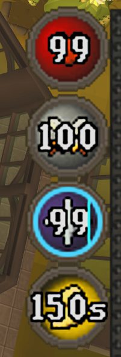
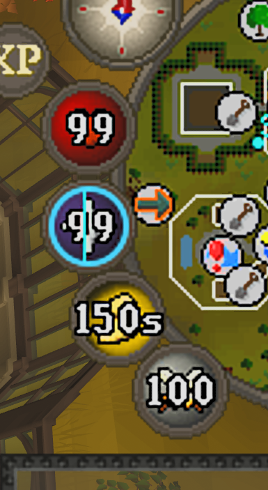

# Orb Only

Removes the side number panels from the hitpoints, prayer, run energy and special attack orbs. Keep values inside the circles, move the labels wherever you like, or hide them for icons only.

| Vertical layout | Minimap layout |
| :---: | :---: |
|  |  |

## Install

Open **Plugin Hub** in RuneLite, search for **Orb Only**, and install it. Open its settings to customise the display.

## Labels

Labels are on by default. Choose a **Label position**:

- **Center**: values sit inside the orbs and shrink to fit.
- **Free (Alt-drag)**: hold Alt and drag each label to move it. Alt-right-click resets a label to its orb. Saved positions are kept when switching back to Center.

Use **Show labels** to switch between values and icons only. Font size and colour are configurable. Hitpoints, run energy and special attack labels keep their native text, including run-energy timers.

## Prayer

By default, active prayers show estimated time remaining; inactive prayers show points. Enable **Show prayer points** to always show points. Estimates use your current points, active prayers and equipment prayer bonus.

Centered estimates of ten minutes or more use whole minutes, such as `12m`. Free labels show the full time. This setting is independent of the core Prayer plugin's orb-text setting.

| Display | Settings to use |
| --- | --- |
| Potion-dose pulse and statistics tooltip | Enable the core **Prayer** plugin and its corresponding options. |
| Prayer tick sweep | Enable **Show prayer tick helper** in Orb Only, plus **Prayer orb** or **Both** as the flick-helper location in the core Prayer plugin. |

## Highlights

**Active prayer and special attack** can highlight the orb border and label. Colours are configurable, and borders also work with labels hidden.

## Poison and venom

**Poison/venom countdown** draws an estimated ring around HP. Colour and thickness are configurable. Observed damage hits resynchronise it; the first interval may be inaccurate if you enable the plugin while already poisoned.

## Compatibility

Orb Only uses your current game artwork, including Resource Packs. It supports layouts with or without the minimap and follows existing orb positions. To move the orbs themselves, use your layout plugin; **Free** moves only the labels.

The circular orbs keep their native actions and right-click options. Disabling Orb Only restores the original appearance.

## Development and license

Build and run instructions are in the [development guide](docs/DEVELOPMENT.md). See [testing](docs/TESTING.md) for regression coverage.

BSD 2-Clause. See [LICENSE](LICENSE) and [third-party notices](THIRD-PARTY-NOTICES.md).
